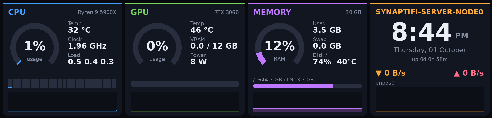

# zalman-lcd

A Linux driver and live dashboard for the 9.1" LCD built into the **Zalman P40 DS** case. The same panel is sold separately as the **ZM-MF916**.

Zalman only supports this screen through its Windows app, OZ-Wide. This project speaks the panel's USB protocol directly, so the screen works on a headless Linux server. No Windows, VM or kernel module is needed.



## Features

- **Dashboard**: CPU (usage, per-core bars, temperature, clock, and VRM temperature on ASUS boards with the `asus-ec-sensors` driver, otherwise load), NVIDIA GPU (usage, temperature, VRAM, power; with several cards, the one with the most VRAM), memory and disk, and a 12-hour clock with network traffic. Each panel has a usage history graph.
- **Systemd service**: starts at boot, reconnects if the screen is unplugged, hands the panel back to its own screen when stopped, and puts it to sleep when the system shuts down.
- **CLI**: change brightness, show an image, reboot the panel, render a preview PNG.

## Hardware

| | |
|---|---|
| Panel | 1920 × 462, landscape |
| USB ID | `1c57:3ed7` "Zalman USB Device" |
| Interface | HID, vendor usage page `0xFF00`, 1024-byte interrupt reports |
| Tested firmware | V1.2.3 (hardware V2.0) |

The panel connects to a USB 2.0 header on the motherboard. Check it's detected with:

```bash
lsusb | grep 1c57:3ed7
```

## Install

Requires a Debian/Ubuntu system with Python 3. An NVIDIA GPU (`nvidia-smi`) is optional; the GPU panel shows "not found" without one.

```bash
git clone <this repo> zalman-lcd
cd zalman-lcd
sudo ./install.sh            # runs the dashboard as the user who ran sudo
```

`install.sh`:
1. Installs `python3-pil`, `python3-psutil` and `fonts-dejavu-core`.
2. Copies `zalman_lcd.py` to `/opt/zalman-lcd/` and links it as `/usr/local/bin/zalman-lcd`.
3. Installs a udev rule that creates `/dev/zalman-lcd` (readable by group `plugdev`), and adds your user to `plugdev`.
4. Installs, enables and starts `zalman-lcd.service`.

To remove everything: `sudo ./uninstall.sh`.

## Usage

### Service

```bash
sudo systemctl status zalman-lcd
sudo systemctl restart zalman-lcd
journalctl -u zalman-lcd -f
```

To change brightness, frame rate or rotation, edit the `ExecStart` line in `/etc/systemd/system/zalman-lcd.service`. Then run `sudo systemctl daemon-reload && sudo systemctl restart zalman-lcd`.

| Flag | Default | Meaning |
|---|---|---|
| `--brightness N` | `80` (service) | 10–100; `0` leaves the panel's setting alone |
| `--fps N` | `2` | frames per second |
| `--rotate DEG` | `0` | rotate the rendered frame |
| `--quality N` | `85` | JPEG quality |
| `--iface NAME` | busiest | network interface shown on the dashboard |

### Other commands

The panel can only be driven by one program at a time, so stop the service first: `sudo systemctl stop zalman-lcd`.

```bash
zalman-lcd info                  # firmware, serial, brightness, ... as JSON
zalman-lcd brightness 60
zalman-lcd image photo.jpg       # show a picture (resized to 1920x462) until Ctrl+C
zalman-lcd off                   # leave realtime mode; the panel shows its own screen
zalman-lcd reboot                # reboot the panel's firmware
```

`snapshot` doesn't touch the panel, so it works while the service runs:

```bash
zalman-lcd snapshot out.png      # render a frame to a PNG
```

## Troubleshooting

**The screen is black but the backlight is on, and the log shows `1 200` for everything.**
The panel's own display program has hung while its command handler still answers. Reboot the panel:

```bash
sudo systemctl stop zalman-lcd
zalman-lcd reboot            # panel drops off USB for ~6 s
sleep 15
sudo systemctl start zalman-lcd
```

If that doesn't help, fully power off the computer, not just a reboot.

**The screen keeps rebooting while the computer is off.**
The motherboard keeps powering the USB header while the PC is off. When the system shuts down, the service puts the panel to sleep (`power suspend`) so it waits quietly for the next boot. That only happens if the service is running at shutdown. If the panel still loops, turn on **ErP / EuP Ready** (or disable "USB power in S5") in the BIOS, so the header loses power when the PC turns off.

**`PermissionError` on `/dev/zalman-lcd`.**
Check the udev rule is installed. Your user must be in `plugdev`; log out and back in after `install.sh` adds you.

**`/dev/zalman-lcd` doesn't exist.**
Check `lsusb` for `1c57:3ed7`. If it's there, run `sudo udevadm trigger --subsystem-match=hidraw`.

**The image is sideways.**
Add `--rotate 90` (or `180`, `270`) to `ExecStart`.

**Two programs fighting over the panel.**
Only one process can stream to it. Stop the service before using `info`, `brightness`, `image`, `off` or `reboot`.

## How it works

Every message is one 1024-byte HID output report. Commands are small HTTP-like text requests (`POST brightness 1 ...` with a JSON body) wrapped in a framed, checksummed envelope. Frames are JPEGs split into 1000-byte chunks behind a 24-byte header. The panel must also receive a heartbeat every 500 ms. The full byte-level spec is in [docs/PROTOCOL.md](docs/PROTOCOL.md), and [docs/REVERSE_ENGINEERING.md](docs/REVERSE_ENGINEERING.md) explains how the protocol was recovered.

## Repository layout

| Path | What it is |
|---|---|
| `zalman_lcd.py` | The whole driver: USB protocol, stats collection, renderers, daemon and CLI |
| `systemd/zalman-lcd.service` | Service template; `install.sh` fills in the user |
| `udev/99-zalman-lcd.rules` | Device permissions and the `/dev/zalman-lcd` name |
| `install.sh` / `uninstall.sh` | Set up / remove everything |
| `docs/PROTOCOL.md` | USB protocol reference |
| `docs/REVERSE_ENGINEERING.md` | How the protocol was recovered from OZ-Wide |
| `tools/decrypt_strings.cs` | Windows helper that decrypts OZ-Wide's obfuscated strings (research only) |

## Disclaimer

Not affiliated with or endorsed by Zalman. The protocol was worked out for interoperability, and no Zalman code or binaries are included. Commands that write to the panel's storage or firmware (`transport`, `recovery`, firmware updates) are deliberately not implemented. Use at your own risk.
